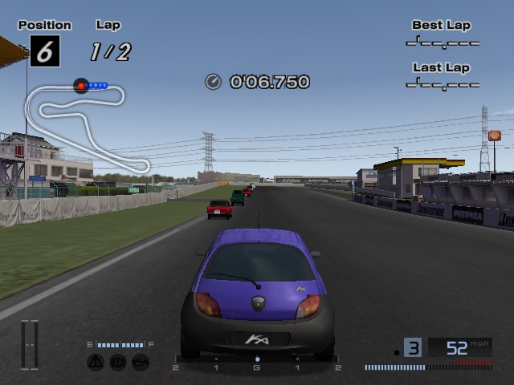

# NextOS Ports

**Ports para portáteis Linux com dados da sua própria cópia do jogo**

[Explorar catálogo](https://nextos-ports.github.io/nextos-universal-ports/#catalogo) · [Como instalar](#como-instalar) · [Suporte](#suporte-no-discord) · [English](#english)

## Catálogo

Ports universais, desenvolvidos para atender à maioria dos portáteis Linux ARM. Confira os requisitos de cada jogo e use os dados da sua própria cópia.

Busque pelo nome do jogo, filtre pela plataforma de origem ou pela arquitetura do port e abra os detalhes para conferir a edição do jogo exigida. Os downloads do site apontam para os ZIPs de cada versão nas Releases do GitHub.

| Plataforma de origem | Guias dos ports |
| --- | --- |
| Android | [ports-android](ports-android/) |
| iOS | [ports-ios](ports-ios/) |
| PlayStation Vita | [ports-vita](ports-vita/) |
| PlayStation 2 | [ports-ps2](ports-ps2/) |
| GameCube | [ports-gamecube](ports-gamecube/) |
| Wii | [ports-wii](ports-wii/) |
| Nintendo Switch | [ports-switch](ports-switch/) |
| PC | [ports-pc](ports-pc/) |
| Web | [ports-web](ports-web/) |

Em cada ficha, **Roda no meu aparelho?** cruza os testes da versão com as características que você informar. Jogos semelhantes levam a outros ports do mesmo gênero ou plataforma. Em **Filtros → Importar biblioteca Steam**, carregue a lista de jogos da sua conta para encontrar os títulos correspondentes. A seção [Em alta](https://nextos-ports.github.io/nextos-universal-ports/#em-alta) acompanha as variações dos downloads no GitHub.

A plataforma de origem identifica a edição que fornece os dados do jogo. Consulte o guia do port para saber quais requisitos e aparelhos foram verificados.

## Como instalar

1. Abra o jogo no [catálogo](https://nextos-ports.github.io/nextos-universal-ports/#catalogo), leia o guia e baixe o ZIP correspondente. A release também oferece SHA-256 quando disponível.
2. Siga os caminhos do guia para instalar o port e copiar os arquivos originais. O arquivo exigido varia por jogo e pode ser APK, IPA, imagem de disco ou arquivos de PC.
3. Abra o port pelo menu do aparelho. Quando o pacote usa o NXExtract, aguarde o preparo inicial. Ao atualizar, preserve os dados preparados, as configurações e os saves indicados no guia.

O [NXExtract](tools/nxextract/) prepara os dados locais usados pelos ports. Para consultar a fonte legada no aplicativo PortMaster, use o [arquivo de configuração](https://github.com/NextOs-Ports/nextos-universal-ports/releases/download/ports-latest/040_nextos.source.json) em `PortMaster/config/`. Os ZIPs atuais do site ficam nas [Releases versionadas](https://github.com/NextOs-Ports/nextos-universal-ports/releases).

## Suporte no Discord

[Entre no servidor da NextOS](https://discord.gg/DHfY62eDNN) e use o [**#port-help**](https://discord.com/channels/1463624170662531082/1531881380349480970) para pedir ajuda ou relatar um bug. Inclua o jogo, a versão do port, o modelo do aparelho, o firmware e o log do erro, se houver. A seção [Suporte do catálogo](https://nextos-ports.github.io/nextos-universal-ports/#suporte) e os detalhes de cada port levam ao mesmo canal.

## Publicação e integração

O [catálogo JSON](https://nextos-ports.github.io/nextos-universal-ports/ports.json) oferece títulos, versões, requisitos registrados e URLs dos downloads para integração. O [workflow de publicação](.github/workflows/site.yml) sincroniza o site com as Releases.

1. Para um port novo, adicione `ports-<plataforma>/<jogo>/README.md` com o título do jogo e seu guia. A imagem opcional usa `<jogo>.screenshot.jpg`.
2. Publique a release `<jogo>-vX.Y.Z` com o anexo `<jogo>.zip`. Use o slug do port já cadastrado nas atualizações.
3. A sincronização atualiza o site automaticamente. Consulte as [regras de nomes e exceções](buildtools/README.md) para os pacotes antigos.

## English

Browse the [NextOS Ports catalog](https://nextos-ports.github.io/nextos-universal-ports/) to find a port, check its supported game edition and download the versioned ZIP. Supply the files from your own copy. Use the filters to select the source platform or ARM architecture.

For help or bug reports, [join the NextOS Discord](https://discord.gg/DHfY62eDNN) and open [#port-help](https://discord.com/channels/1463624170662531082/1531881380349480970). Include the port version, device, firmware and error log when available.

## ⚖️ Aviso legal / Legal notice

Os ZIPs distribuem o port, suas dependências e a documentação. **Os dados originais do
jogo vêm da cópia do jogador.** Consulte os avisos de licença incluídos no ZIP.
Todas as marcas e jogos pertencem aos seus respectivos detentores.
Detentores de direitos que queiram falar conosco: abram uma issue ou contatem pelo Discord.

Packages contain the port, its dependencies, and documentation. **Supply the original
game data from your own copy.** See the license notices included in the ZIP.
All trademarks and games belong to their respective owners. Rights holders can open an
issue or contact us on Discord.

---

[NextOs-Ports](https://github.com/NextOs-Ports)

